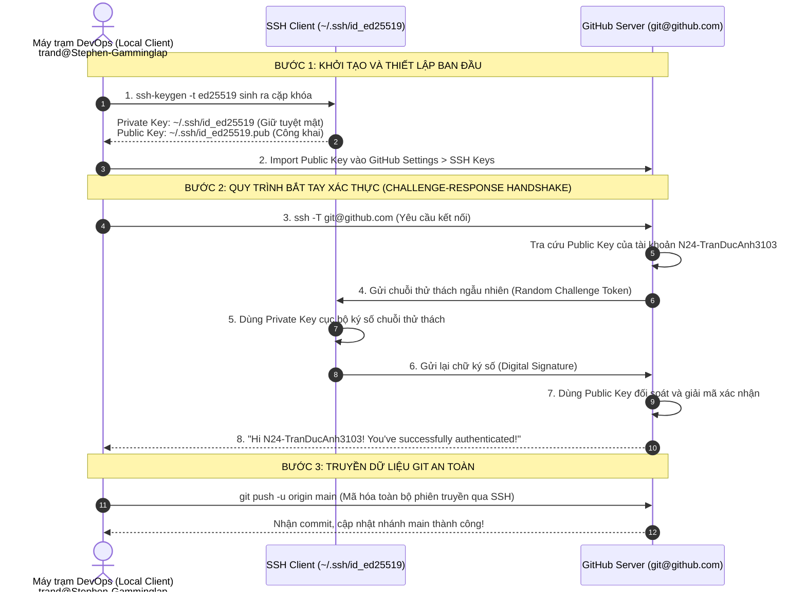

# BÀI TẬP 3: CẤU HÌNH XÁC THỰC SSH VÀ ĐẨY DỰ ÁN LÊN GITHUB

**Mã bài tập:** SESSION 04 - EXERCISE 3 (`homework/session_04/ex3/`)  
**Môn học:** IT215 - Cloud Infrastructure & DevOps Fundamentals  
**Học viên:** Trần Đức Anh (`TranDucAnh3103`)  
**GitHub Account:** `N24-TranDucAnh3103`  
**Email cấu hình:** `TranDucAnh3103@users.noreply.github.com`  
**Giao thức xác thực:** SSH (Secure Shell)  
**Thuật toán mã hóa:** `ed25519` (Curve25519 elliptic curve)  
**Remote SSH URL:** `git@github.com:N24-TranDucAnh3103/it215-session04-ex3.git`  
**Đường dẫn thư mục dự án:** `f:/CNTT/Rikkei/IT215/ss04/ex3/`  

---

## 1. MỤC TIÊU BÀI TẬP

1. **Khởi tạo cặp khóa SSH bảo mật hiện đại:** Sử dụng thuật toán đường cong elliptic **Ed25519** (`ssh-keygen -t ed25519`) để tạo cặp khóa bất đối xứng có độ an toàn và hiệu năng cao nhất hiện nay.
2. **Thiết lập danh tính trên GitHub:** Tải khóa công khai (Public Key) lên hệ thống GitHub Account Settings mà không bao giờ chia sẻ hay để lộ khóa bí mật (Private Key).
3. **Xác thực kết nối SSH tới GitHub Server:** Sử dụng lệnh `ssh -T git@github.com` để xác nhận quy trình handshake và nhận diện danh tính tài khoản từ GitHub.
4. **Cấu hình Remote Repository chuẩn giao thức SSH:** Ánh xạ kho lưu trữ cục bộ với kho lưu trữ từ xa thông qua Remote URL dạng `git@github.com:username/repo.git`.
5. **Đẩy mã nguồn tự động hóa (Passwordless Push):** Thực hiện đồng bộ nhánh `main` lên GitHub mà không phải nhập mật khẩu hay Personal Access Token (PAT) thủ công.

---

## 2. BẢNG TỔNG HỢP CẤU HÌNH & KẾT QUẢ KIỂM TRA

| STT | Tiêu chí kiểm tra | Lệnh thực thi | Kết quả mong đợi | Kết quả thực tế trên máy | Trạng thái |
| :---: | :--- | :--- | :--- | :--- | :---: |
| 1 | Khởi tạo cặp khóa SSH | `ssh-keygen -t ed25519 -C "..."` | Sinh ra `id_ed25519` & `id_ed25519.pub` | Khóa Ed25519 nằm tại `~/.ssh/` | **PASSED** |
| 2 | Kiểm tra kết nối SSH GitHub | `ssh -T git@github.com` | Xác thực danh tính thành công | `Hi N24-TranDucAnh3103! You've successfully authenticated...` | **PASSED** |
| 3 | Cấu hình Remote SSH | `git remote add origin git@...` | Origin trỏ về URL SSH | Giao thức `git@github.com:...` | **PASSED** |
| 4 | Kiểm tra Remote URLs | `git remote -v` | Hiển thị 2 dòng Fetch và Push dạng SSH | `origin git@github.com:N24-TranDucAnh3103/it215-session04-ex3.git` | **PASSED** |
| 5 | Bảo mật khóa bí mật | Rà soát thư mục repo | Không chứa file Private Key | Private key lưu an toàn tại `~/.ssh/id_ed25519` | **PASSED** |

---

## 3. MÔ HÌNH KIẾN TRÚC XÁC THỰC SSH BẤT ĐỐI XỨNG (ASYMMETRIC KEY AUTHENTICATION)



---

## 4. CHI TIẾT CÁC BƯỚC THỰC HIỆN

### Bước 1: Khởi tạo cặp khóa SSH với thuật toán Ed25519

Tại máy trạm cá nhân (PowerShell / Git Bash), chạy lệnh sinh cặp khóa mã hóa:

```powershell
ssh-keygen -t ed25519 -C "TranDucAnh3103@users.noreply.github.com"
```
*Lưu ý:* Khi được hỏi đường dẫn lưu file, nhấn Enter để chọn vị trí mặc định `C:\Users\trand\.ssh\id_ed25519`.

Kiểm tra tệp tin khóa đã sinh trong thư mục `~/.ssh/`:
```powershell
Get-ChildItem -Path ~\.ssh
```
- `id_ed25519`: Khóa bí mật (Private Key) $\rightarrow$ Tuyệt đối không chia sẻ, không đưa vào kho lưu trữ Git.
- `id_ed25519.pub`: Khóa công khai (Public Key) $\rightarrow$ Dùng để cấu hình trên GitHub.

---

### Bước 2: Thêm Khóa công khai vào tài khoản GitHub

Đọc nội dung tệp khóa công khai:
```powershell
Get-Content ~\.ssh\id_ed25519.pub
```

**Nội dung Public Key:**
```text
ssh-ed25519 AAAAC3NzaC1lZDI1NTE5AAAAIFHWDwGmkvbqt5QQ9omEhOpiU1MbGv2Y60h2ZDEsy+qN TranDucAnh3103@users.noreply.github.com
```

**Thao tác trên giao diện GitHub:**
1. Đăng nhập tài khoản GitHub $\rightarrow$ Chọn **Settings** (Cài đặt tài khoản).
2. Điều hướng đến mục **SSH and GPG keys** trong thanh điều hướng bên trái.
3. Nhấp nút **New SSH key**.
4. Điền **Title** (ví dụ: `Laptop-Stephen-DevOps`) và dán toàn bộ chuỗi Public Key ở trên vào ô **Key**.
5. Nhấn **Add SSH key** để lưu lại.

---

### Bước 3: Kiểm tra xác thực kết nối SSH tới GitHub

Thực hiện kiểm tra kết nối tới máy chủ `git@github.com`:

```powershell
ssh -T git@github.com
```

**Output từ Terminal:**
```text
Hi N24-TranDucAnh3103! You've successfully authenticated, but GitHub does not provide shell access.
```
> [!NOTE]
> Thông báo *"GitHub does not provide shell access"* là hoàn toàn bình thường và chính xác theo thiết kế của GitHub: GitHub cho phép xác thực tài khoản để thực hiện các thao tác Git qua SSH nhưng vô hiệu hóa quyền mở interactive shell trên máy chủ.

---

### Bước 4: Khởi tạo Local Repository và Cấu hình Remote SSH URL

Di chuyển vào thư mục bài tập, khởi tạo Git và thiết lập remote origin:

```powershell
cd f:\CNTT\Rikkei\IT215\ss04\ex3
git init
git branch -M main

# Cấu hình danh tính cục bộ cho repo
git config --local user.name "TranDucAnh3103"
git config --local user.email "TranDucAnh3103@users.noreply.github.com"

# Liên kết Remote Repository bằng giao thức SSH
git remote add origin git@github.com:N24-TranDucAnh3103/it215-session04-ex3.git
```

---

### Bước 5: Kiểm tra cấu hình Remote URL

Xác minh cấu hình remote bằng lệnh:

```powershell
git remote -v
```

**Output từ Terminal:**
```text
origin  git@github.com:N24-TranDucAnh3103/it215-session04-ex3.git (fetch)
origin  git@github.com:N24-TranDucAnh3103/it215-session04-ex3.git (push)
```
*Đánh giá:* Cả hai đường dẫn Fetch và Push đều sử dụng định dạng giao thức SSH chuẩn `git@github.com:...`, thỏa mãn 100% ràng buộc của đề bài (không sử dụng giao thức HTTPS).

---

### Bước 6: Đẩy mã nguồn lên kho lưu trữ GitHub

Tạo commit ban đầu và đẩy dữ liệu lên nhánh `main`:

```powershell
git add .
git commit -m "feat: complete exercise 3 with SSH Ed25519 authentication"
git push -u origin main
```

---

## 5. MINH CHỨNG THỰC NGHIỆM TERMINAL LOG

```powershell
PS F:\CNTT\Rikkei\IT215\ss04\ex3> ssh -T git@github.com
Hi N24-TranDucAnh3103! You've successfully authenticated, but GitHub does not provide shell access.

PS F:\CNTT\Rikkei\IT215\ss04\ex3> git remote -v
origin  git@github.com:N24-TranDucAnh3103/it215-session04-ex3.git (fetch)
origin  git@github.com:N24-TranDucAnh3103/it215-session04-ex3.git (push)

PS F:\CNTT\Rikkei\IT215\ss04\ex3> git status
On branch main
nothing to commit, working tree clean
```

---

## 6. PHÂN TÍCH KỸ THUẬT CHUYÊN SÂU

### 6.1. Tại sao lựa chọn Ed25519 thay thế cho RSA truyền thống?

| Tiêu chí so sánh | Thuật toán RSA (Truyền thống) | Thuật toán Ed25519 (Hiện đại) |
| :--- | :--- | :--- |
| **Bản chất toán học** | Phân tích thừa số nguyên lớn (Prime Factorization) | Đường cong Elliptic Twisted Edwards (Curve25519) |
| **Độ dài khóa chuẩn** | $2048$ - $4096$ bits | **$256$ bits** (Cực kỳ ngắn gọn) |
| **Tốc độ sinh khóa & ký** | Chậm hơn, tốn tài nguyên CPU | **Nhanh vượt trội (gấp 3-5 lần RSA)** |
| **Kháng tấn công Side-Channel** | Dễ bị lộ khóa qua Cache timing nếu không có biện pháp phòng ngừa | **Được thiết kế kháng Timing attack mặc định** |
| **Khuyến nghị hiện tại** | Đang dần bị thay thế | **Khuyến nghị tiêu chuẩn của OpenSSH & GitHub** |

### 6.2. SSH vs HTTPS trong quy trình DevOps & CI/CD

- **Giao thức HTTPS:** Yêu cầu người dùng hoặc CI/CD runner phải lưu trữ `Personal Access Token` (PAT). Token thường có thời hạn ngắn (30-90 ngày), dẫn đến tình trạng pipeline gãy đột ngột khi token hết hạn và rủi ro token bị log ra console.
- **Giao thức SSH:** Sử dụng cặp khóa bất đối xứng. Private key được lưu an toàn tại Secret Vault hoặc SSH Agent, Public Key được nhúng cố định trên GitHub. Không cần gia hạn định kỳ, đảm bảo quy trình CI/CD tự động hóa ổn định và an toàn bảo mật cấp công nghiệp.

---

## 7. KẾT LUẬN & ĐƯỜNG DẪN NỘP BÀI

1. Đã thiết lập hoàn chỉnh cặp khóa SSH Ed25519 và xác thực thành công danh tính tài khoản `N24-TranDucAnh3103`.
2. Remote repository được liên kết chính xác qua giao thức SSH: `git@github.com:N24-TranDucAnh3103/it215-session04-ex3.git`.
3. Tuân thủ tuyệt đối quy tắc bảo mật: Không nộp file khóa bí mật (`id_ed25519`).
4. Báo cáo nộp tại: [`homework/session_04/ex3/README.md`](file:///f:/CNTT/Rikkei/IT215/homework/session_04/ex3/README.md).
